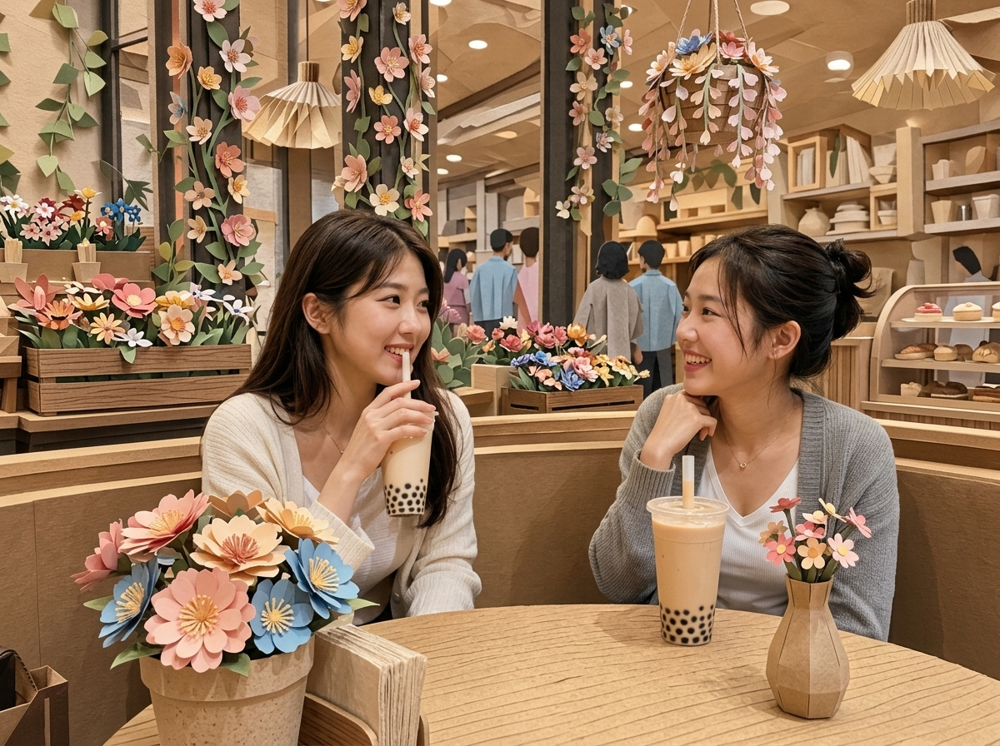

# 🎨 PaperWorldPhoto (Universal 3D Papercraft Diorama Skill)

> **全平台 AI Agent 通用技能**：将普通生活/旅行照片重构为可触摸的高级写实 3D 手工纸艺微缩世界。
> **Universal AI Agent Skill**: Transforms everyday portraits and travel photos into tangible, high-density 3D handcrafted paper art diorama worlds.

[](https://opensource.org/licenses/MIT)
[](#)
[](#)

---

## 🌟 效果展示 (Visual Showcase)

| 案例 1：花海工坊 (Flower Workshop) | 案例 2：咖啡厅下午茶 (Cafe Afternoon Tea) |
| :---: | :---: |
|  |  |

| 案例 3：街角咖啡长椅 (Street Cafe) | 案例 4：海边夏日微风 (Seaside Breeze) |
| :---: | :---: |
|  |  |

| 案例 5：湖畔荡秋千 (Lake Swing) |
| :---: |
|  |

---

## 💡 核心视觉规范 (Core Standards)

1. **真人单反质感 (Subject Realism 92+)**：保留人物自然皮肤肌理、真实发丝光泽与真实布料质感，杜绝纸片脸、塑料假人与蜡像 CGI。
2. **环境硬核纸艺化 (Tactile Paperization 92+)**：建筑、门窗、桌椅、街道全部用分层卡纸、手撕边牛皮纸与折纸重构，具备可见物理厚度与柔和真实阴影。
3. **空间三层纵深 (3D Diorama Depth)**：明确前景道具、中景主体与家具、背景空间轮廓。
4. **强制融入立体花植 (Mandatory Florals)**：每一个场景都必须扎实长出多层剪纸花卉与藤蔓（花盆、立柱花藤、花箱、悬垂花篮），赋予微缩纸质空间蓬勃生命力。
5. **建筑形态精准识别 (10 大建筑预设)**：先识别红砖、石材、玻璃幕墙、传统木构、工业遗产等形态，再动态匹配纸艺材质语法。

---

## 📁 全通用项目架构 (Universal Directory Structure)

```text
paperworldphoto/
├── SKILL.md                          # 标准 Agent Skill 入口 (Codex / Antigravity / Claude Code / Cline 通用)
├── README.md                         # 详细多 Agent 安装与接入文档
├── LICENSE                           # MIT 开源许可证
├── pyproject.toml                    # Python 包与 CLI 安装配置
│
├── adapters/                         # 专为各大主流 Agent 平台封装的无缝适配层
│   ├── cursor/
│   │   └── .cursorrules             # Cursor IDE / Trae 专用规则文件
│   ├── windsurf/
│   │   └── .windsurfrules           # Windsurf 专用规则文件
│   ├── gpts/
│   │   └── custom_instruction.md    # ChatGPT Custom GPTs / Claude Project 复制即用设定
│   ├── coze/
│   │   └── coze_bot_prompt.md       # 字节跳动扣子 (Coze) / 豆包智能体 Prompt 与变量模板
│   ├── dify/
│   │   └── dify_tool_dsl.yml        # Dify 自定义工具 / 工作流 DSL 规范
│   └── mcp/
│       └── mcp_server.py            # Model Context Protocol (MCP) 独立服务 (Claude Desktop/Cursor)
│
├── src/                              # Python 核心引擎 (可在任何 Python Agent 框架中直接调用)
│   ├── __init__.py
│   ├── compiler.py                  # Prompt 编译核心引擎
│   ├── quality_gate.py              # 5 维度质量检查与纠偏逻辑
│   └── cli.py                       # 终端命令行工具
│
├── presets/                          # 预设配置库
│   ├── architecture_presets.yaml     # 10 类典型建筑风格纸艺翻译预设
│   └── scene_presets.yaml            # 7 类典型生活与户外场景预设
├── prompts/                          # 提示词库
│   ├── master_prompt.md              # 母提示词标准化模板
│   └── system_prompt_universal.txt   # 单文件纯文本通用系统提示词
└── rules/                            # 质量控制
    └── quality_gate.md               # 质检检查单
```

---

## 🚀 各类 Agent 接入指南 (Universal Agent Integration)

### 1. OpenAI Codex / CodeX Agents
复制或软链接到用户的技能目录即可自动识别：
```bash
# 全局生效
cp -r paperworldphoto ~/.agents/skills/paperworldphoto
# 或在当前工作区
cp -r paperworldphoto .agents/skills/paperworldphoto
```

### 2. Google Antigravity
复制到 Antigravity 全局 skills 配置库：
```bash
cp -r paperworldphoto ~/.gemini/config/skills/paperworldphoto
```

### 3. Cursor / Windsurf / Trae
直接将 `adapters/cursor/.cursorrules` 复制到项目根目录，或者在 Cursor 设置的 System Rules 中贴入内容。

### 4. Claude Desktop / 支持 MCP 的智能体系统
在 `claude_desktop_config.json` 中挂载本项目的 MCP Server：
```json
{
  "mcpServers": {
    "paperworldphoto": {
      "command": "python",
      "args": ["path/to/paperworldphoto/adapters/mcp/mcp_server.py"]
    }
  }
}
```

### 5. ChatGPT (Custom GPTs) / Claude Projects
在 GPTs 创建页面或 Claude Project 的 **Instructions** 中，直接复制并粘贴 `adapters/gpts/custom_instruction.md` 全文。

### 6. 字节跳动扣子 (Coze) / Dify / FastGPT
- **扣子 (Coze)**：将 `adapters/coze/coze_bot_prompt.md` 作为 Bot 的“人设与回复逻辑”。
- **Dify**：在“自定义工具 (Custom Tool)”中导入 `adapters/dify/dify_tool_dsl.yml`。

### 7. Python 开发者 / LangChain / CrewAI / 自研 Agent
可在任何 Python 项目中直接安装并调用：
```bash
pip install -e .
```
```python
from paperworldphoto import PaperWorldCompiler

compiler = PaperWorldCompiler()
result = compiler.compile(
    subject_desc="a woman drinking coffee on a chair",
    scene_type="cafe",
    arch_style="historic_red_brick_urban",
    mandatory_florals=True,
    aspect_ratio="4:3"
)
print(result["prompt"])
```

或使用命令行快速生成生图提示词：
```bash
python -m src.cli --subject "two young women having afternoon tea" --scene cafe
```

---

## 📄 开源许可证
本项目采用 [MIT License](LICENSE)。欢迎自由分发、改进及在商业项目中应用！
